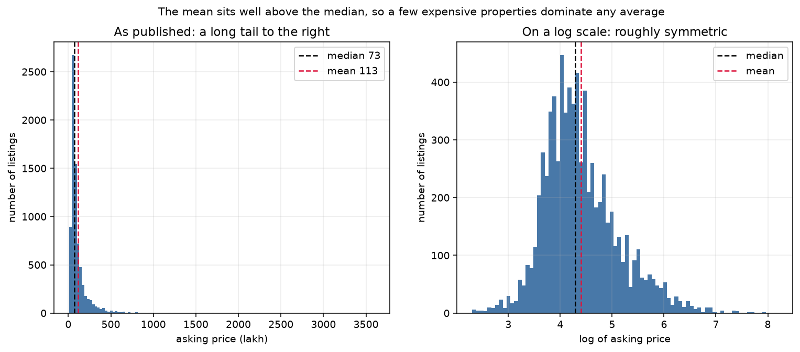
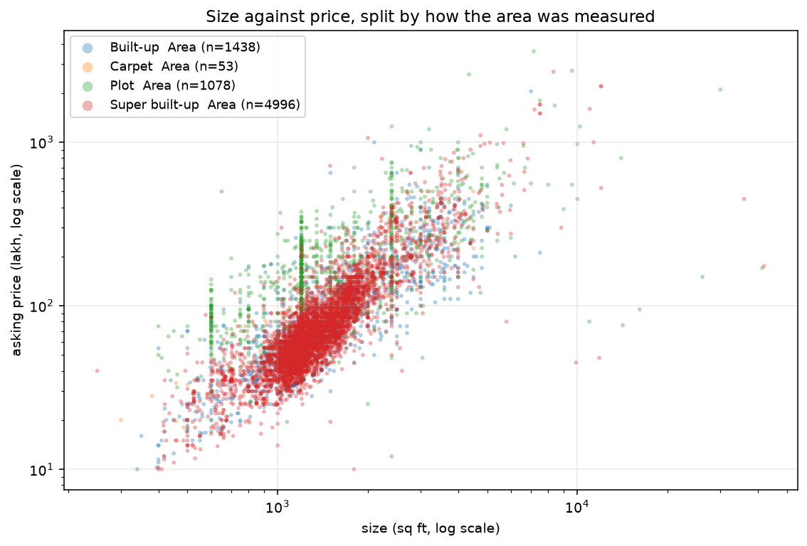
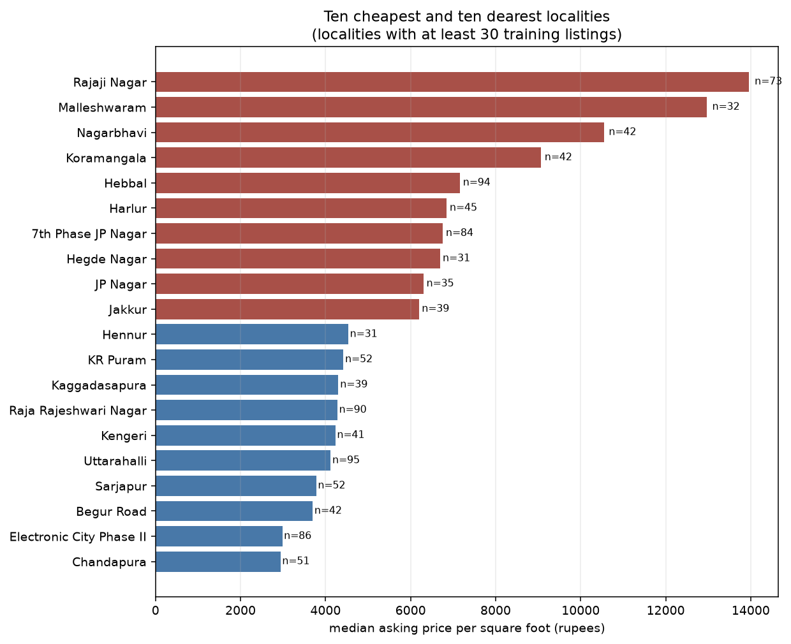
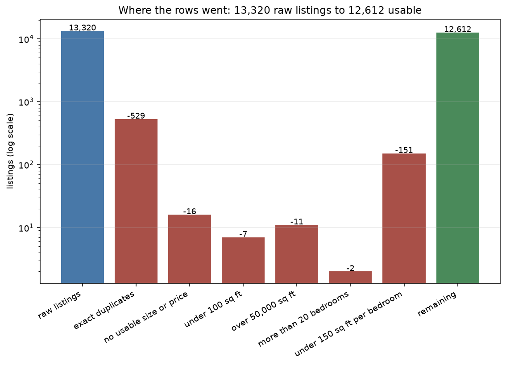
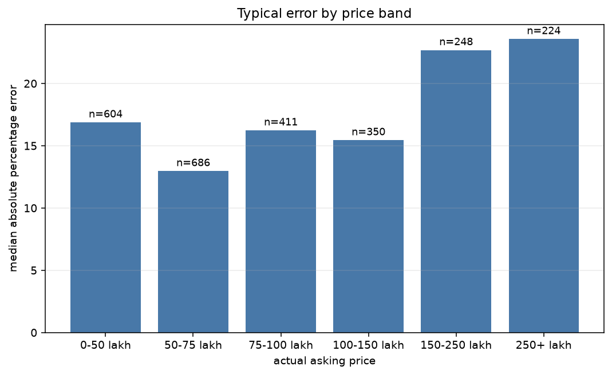
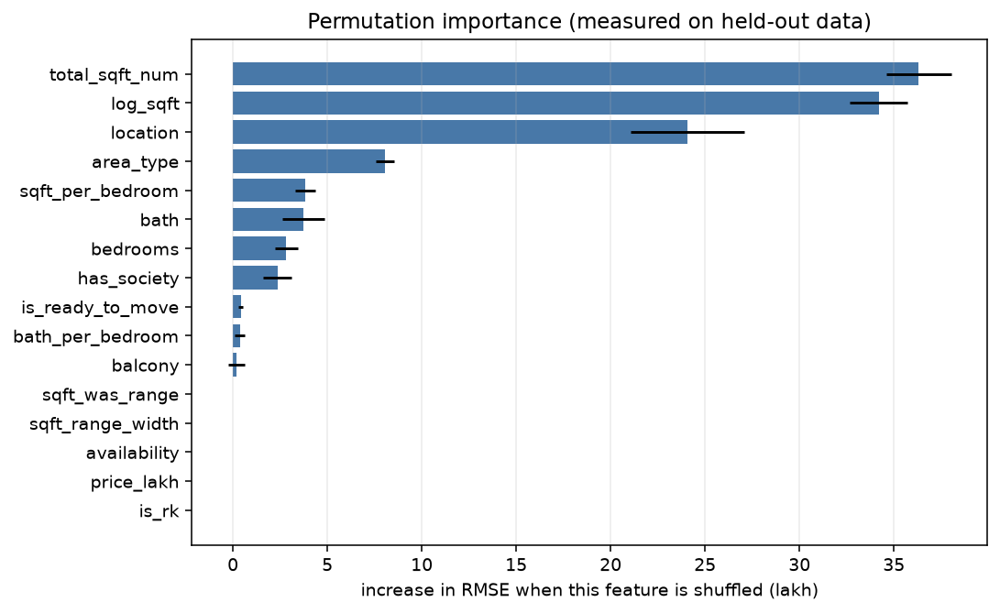
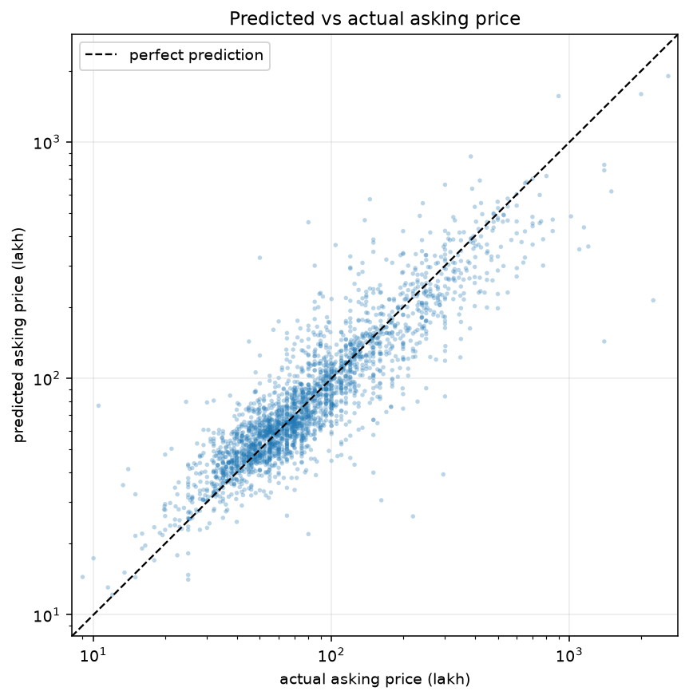
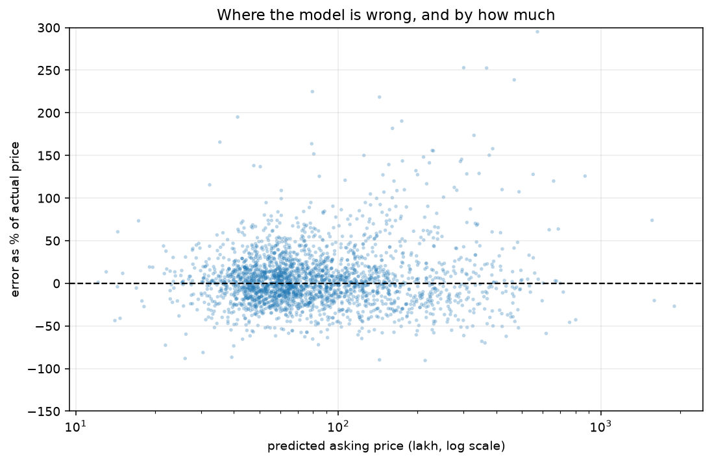
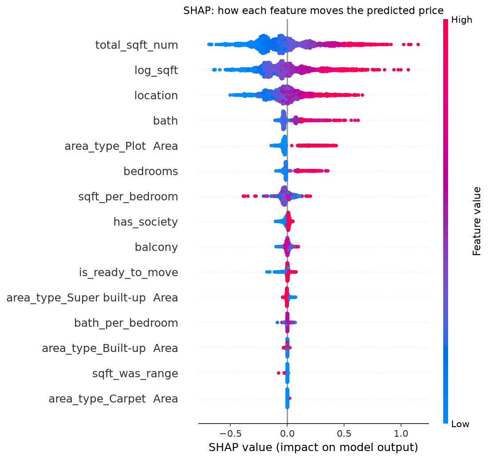

# Bengaluru House Price Prediction

Predicting the **asking price** of residential property listings in Bengaluru, India.

Every number in this README was produced by a script in this repository and can be
regenerated by running it. Nothing is quoted from memory or from a run that no
longer exists.

## Headline result

On a test set of 2,523 listings that were not used to clean, train, select or tune
anything:

| | Final model | Price per sq ft × size | Predict the median |
|---|---|---|---|
| **Median absolute % error** | **16.2%** | 19.9% | 41.2% |
| Mean absolute error | ₹30.73 lakh | ₹40.54 lakh | ₹65.02 lakh |
| RMSE | ₹83.97 lakh | ₹113.05 lakh | ₹152.10 lakh |
| MAPE | 24.1% | 29.2% | 51.3% |
| R² | 0.669 | 0.400 | −0.085 |

Half of all predictions land within **16.2%** of the asking price. The model's mean
absolute error is **24.2% below** the price-per-square-foot rule and **52.7% below**
predicting the median.

The comparison against the price-per-sq-ft baseline is the one that matters. Beating
"predict the median" only shows the model learned *something*. Beating a sensible
domain rule is what shows the machine learning earned its place.

## What this project predicts, and what it does not

The target variable is the **price a property was listed at**, not the price it sold
for. These are listings scraped from a property portal, not registered transactions.

This distinction matters and is not a technicality:

- Asking prices are set by sellers and agents, and in a soft market they sit above
  what properties actually achieve.
- There is no official, openly published, transaction-level record of Indian
  residential property sales. The Reserve Bank of India publishes a city-level
  housing price *index*, but that is a quarterly aggregate and cannot be used to
  predict the price of an individual property.

So this project is honest about its scope: it models what sellers ask, which is a
useful and well-defined question, rather than pretending to model what buyers pay.

## Data

| | |
|---|---|
| Rows | 13,320 |
| Columns | 9 |
| City | Bengaluru |
| Period | Listings described in the source as reflecting the 2017 market |
| Licence | CC0 (public domain) as published on OpenML |

### Provenance

The dataset originates as `Bengaluru_House_Data.csv`, published on Kaggle
(`amitabhajoy/bengaluru-house-price-data`), scraped from property portal listings.

Kaggle requires an account to download, so the file used here was obtained from a
public mirror and then **verified against an independent copy** before being used:

| Check | Result |
|---|---|
| Row count vs OpenML dataset 46284 | 13,320 in both — match |
| Column names | `area_type, availability, location, size, society, total_sqft, bath, balcony, price` |
| SHA-256 of `Bengaluru_House_Data.csv` | `23ddf71be7d79a259b62e125b9d56cb531f9d051b0da650c0fe7cc82365a1015` |
| SHA-256 of `bengaluru_real_estate_price.arff` (OpenML copy) | `b0175b86e375176846c1e0b80f709f403129688274d420346fd589547d3c122f` |

**A deliberate choice about which copy to use.** The OpenML copy is more convenient:
`total_sqft` arrives already numeric with no missing values. It was rejected as the
primary source precisely *because* of that. In the published data `total_sqft` is a
text column containing values such as `2100 - 2850` and `34.46Sq. Meter`; OpenML has
converted it by a method that is not documented anywhere in the dataset record. Using
it would have meant building on a transformation that could not be described or
defended.

The OpenML copy is kept as a **cross-check**: once `total_sqft` is parsed here, the
result can be compared against OpenML's independently produced numeric column.

Data files are not committed to this repository. See [Reproducing](#reproducing).

### What the raw data actually looks like

Produced by `scripts/explore_raw.py`:

**Missing values**

| Column | Missing | % |
|---|---|---|
| `society` | 5,502 | 41.31% |
| `balcony` | 609 | 4.57% |
| `bath` | 73 | 0.55% |
| `size` | 16 | 0.12% |
| `location` | 1 | 0.01% |
| `area_type`, `availability`, `total_sqft`, `price` | 0 | 0.00% |

**Distinct values**

| Column | Distinct |
|---|---|
| `location` | 1,305 |
| `society` | 2,688 |
| `total_sqft` | 2,117 |
| `price` | 1,994 |
| `availability` | 81 |
| `size` | 31 |
| `bath` | 19 |
| `area_type` | 4 |
| `balcony` | 4 |

**Known problems in the raw data, all of which the pipeline must handle**

1. **529 exactly duplicated rows.** These must be removed *before* the train/test
   split. If they are not, the same listing can appear in both training and test
   data, and the test score becomes optimistic — a leak.
2. **`total_sqft` is not numeric.** 13,073 values are plain numbers; 247 are not.
   Of those, 201 are ranges (`2100 - 2850`) and 46 carry units
   (`34.46Sq. Meter`, `4125Perch`, plus Acres, Cents, Guntha, Grounds, Sq. Yards).
3. **`size` is free text** with two different conventions for the same thing:
   `2 BHK` (5,199 rows) and `2 Bedroom` (329 rows) both mean two bedrooms.
4. **`location` has a long tail** — 1,305 distinct values over 13,320 rows, so many
   locations appear only once or twice.
5. **`society` is 41% missing**, which is itself likely to be informative rather
   than random.
6. **`area_type` is not comparable across rows.** Carpet area, built-up area and
   super built-up area measure different things, so the same `total_sqft` figure
   means different amounts of usable space depending on this column.

**`price` as published**

| | |
|---|---|
| Count | 13,320 |
| Min | 8.0 |
| 25th percentile | 50.0 |
| Median | 72.0 |
| Mean | 112.57 |
| 75th percentile | 120.0 |
| Max | 3,600.0 |

The source documents this column as being in **lakhs** (1 lakh = ₹100,000), which is
consistent with the distribution above: a median of ₹72 lakh for Bengaluru property.
The mean sits well above the median, so the distribution is strongly right-skewed.

## The data, in pictures

Drawn from the **training set only** (`scripts/explore_figures.py`). Looking at a
chart is a way of learning from data, so plotting the test set and then making
decisions would leak just as surely as fitting on it.

**Why the model is trained on `log(price)`.** The mean asking price (₹113 lakh)
sits well above the median (₹73 lakh), so a small number of very expensive
properties dominate any average. On a log scale the distribution is roughly
symmetric, which is a far better shape to fit.



**Size against price**, separated by how the area was measured. The relationship is
close to a straight line on log–log axes, which is why `log_sqft` is a feature.

Two things visible here that are not in any summary table. The vertical stripes are
real: sizes cluster on round numbers like 600, 1,200 and 2,400 sq ft, because
listings are advertised in round figures. And plot-area listings (green) sit
noticeably higher at large sizes — a 4,000 sq ft plot is not the same product as a
4,000 sq ft flat.



**Locality matters enormously.** Median asking price per square foot varies almost
fivefold across the city, from about ₹2,957 in Chandapura to ₹13,958 in Rajaji
Nagar. This is why encoding locality by its typical price beat giving each of 1,265
localities its own column.



**What cleaning removed, and why.** 13,320 raw listings become 12,612 usable ones.
The log scale is needed because the largest category (529 exact duplicates) is two
hundred times the smallest (2 listings claiming more than 20 bedrooms).



## Method

### The split, made before anything was fitted

`scripts/make_splits.py`, seed 42.

| Split | Rows | Share |
|---|---|---|
| Train | 7,565 | 60.0% |
| Validation | 2,524 | 20.0% |
| Test | 2,523 | 20.0% |

Three sets, not two. Training teaches the model; validation chooses between models
and settings; test is scored **once**, at the end. A two-way split makes the same
data choose the model and judge it, and the reported score comes out flattering.

**The split is grouped, not random.** The same property appears more than once with
a different availability date. 12,612 cleaned rows contain only 12,448 distinct
properties, so 164 rows share a property with another row. A plain row-wise shuffle
could put one copy in training and another in test, scoring the model on something
it had memorised. Listings sharing a fingerprint of locality, size, bedrooms,
bathrooms, balconies and price are kept on the same side of the split.

Verified afterwards: properties shared between train and validation, train and test,
and validation and test are **0, 0 and 0**.

**Locations unseen in training**: 5.47% of validation rows and 5.83% of test rows
are in a locality that never appears in the training set. This is a consequence of
1,265 localities over 12,612 rows, and it is reported rather than hidden — see
[Limitations](#limitations).

### Leakage, and what was done about it

| Risk | Handling |
|---|---|
| Duplicate listings across the split | Exact duplicates dropped before splitting; near-duplicates grouped |
| Imputation medians learned from all data | `SimpleImputer` sits inside the pipeline, refitted on each fold |
| Encoder categories learned from all data | `OneHotEncoder` / `TargetEncoder` inside the pipeline |
| Scaling learned from all data | `StandardScaler` inside the pipeline |
| Locality price encoding reading its own row | `TargetEncoder` cross-fits internally |
| Outlier removal using the target | Not done. Plausibility rules use physical limits only, never price |

The test suite checks these rather than asserting them. `tests/test_pipeline.py`
fits on data whose bathroom median is 2, then transforms new data whose own median
is 50 with one value missing, and asserts the gap is filled with **2**.

### Model selection

5-fold grouped cross-validation on the **training set only**.

| Model | CV RMSE (lakh) |
|---|---|
| Ridge, one column per locality | 97.59 ± 11.36 |
| LightGBM, one column per locality | 94.98 ± 16.90 |
| Random Forest, one column per locality | 94.27 ± 13.98 |
| Ridge, locality target-encoded | 92.33 ± 8.01 |
| LightGBM, locality target-encoded | 88.63 ± 12.61 |
| LightGBM, tuned over 40 settings (966s) | 86.34 ± 12.92 |
| **Random Forest, locality target-encoded** | **85.91 ± 12.62** |

> Provenance note: this table comes from `scripts/tune.py`. After that run,
> `TargetEncoder` was changed to take an explicit cross-validator, replacing a
> `random_state` argument deprecated in scikit-learn 1.9. The chosen configuration
> was re-run after the change by `scripts/evaluate.py` and produced the identical
> 85.91 ± 12.62. The other target-encoded rows have not been regenerated since the
> change, so they are from the earlier run.

Two findings worth stating plainly:

**Target-encoding locality was the single change that helped.** It improved every
model family, in the same direction, by a similar amount. The gain for any one model
is smaller than that model's fold-to-fold spread, so no single row is convincing —
but three different algorithms do not all get lucky the same way, and the spread
*narrowed* as well (Ridge from ±11.36 to ±8.01).

**Tuning was not worth much.** A 40-setting randomised search over LightGBM, costing
966 seconds, produced 86.34 ± 12.92 — still behind a Random Forest left on sensible
defaults. Since only LightGBM was tuned, the comparison is deliberately unfair in
its favour, which makes choosing Random Forest the conservative call rather than a
lucky one.

### The chosen model

Random Forest, 300 trees, `min_samples_leaf=2`, locality target-encoded, trained on
`log(price)`.

The log target is not decoration. Prices run from ₹8 lakh to ₹3,600 lakh and are
heavily right-skewed; fitting on raw price lets a handful of very expensive
properties dominate the loss. Training on the log makes the model minimise
*proportional* error. It also makes a negative predicted price arithmetically
impossible, which a linear model on raw prices will otherwise produce for unusually
small properties. All metrics are converted back to rupees before reporting.

## Results

Cross-validated RMSE on the training set for this configuration: **85.91 ± 12.62
lakh**. Test RMSE: **83.97 lakh**. The test figure sits inside the cross-validation
spread, which is the expected outcome and is weak evidence that nothing has gone
badly wrong.

### Where the model fails

| Actual price | n | Median abs % error | MAE (lakh) |
|---|---|---|---|
| 0–50 lakh | 604 | 16.9% | 9.37 |
| 50–75 lakh | 686 | **13.0%** | 11.55 |
| 75–100 lakh | 411 | 16.2% | 21.22 |
| 100–150 lakh | 350 | 15.4% | 28.21 |
| 150–250 lakh | 248 | 22.7% | 51.51 |
| 250+ lakh | 224 | **23.6%** | 145.41 |



The model is most reliable in the ₹50–75 lakh band, which is the thickest part of
the market, and least reliable above ₹150 lakh. Expensive properties are scarce in
the training data and differ from one another in ways the eight available columns do
not capture.

| Locality | n | Median abs % error | MAE (lakh) |
|---|---|---|---|
| Seen in training | 2,406 | 15.8% | 29.78 |
| **Never seen in training** | **117** | **28.2%** | **50.24** |

Error roughly **doubles** for a locality the model has never encountered. For a
valuation tool this is the most practically important limitation on this list: the
model should say "I don't know this area" rather than answer confidently.

### What drives a prediction

Permutation importance on the test set — each feature shuffled in turn, and the
increase in RMSE measured.

| Feature | Increase in RMSE (lakh) |
|---|---|
| `total_sqft_num` | 36.32 ± 1.71 |
| `log_sqft` | 34.20 ± 1.52 |
| `location` | 24.07 ± 3.01 |
| `area_type` | 8.05 ± 0.50 |
| `sqft_per_bedroom` | 3.83 ± 0.54 |
| `bath` | 3.72 ± 1.11 |
| `bedrooms` | 2.83 ± 0.60 |
| `has_society` | 2.35 ± 0.77 |
| `is_ready_to_move` | 0.41 ± 0.11 |
| `bath_per_bedroom` | 0.36 ± 0.27 |
| `balcony` | 0.17 ± 0.44 |
| `price_lakh` | −0.00 ± 0.00 |



Size dominates, then locality, then whether the quoted area is carpet, built-up or
super built-up. Bedroom count adds little once size is known, which is reasonable:
size already implies it.

**A caution about the top two rows.** `total_sqft_num` and `log_sqft` are the same
information twice. Permutation importance is unreliable when features are
correlated, because shuffling one leaves the model able to recover the information
from the other. These two numbers should be read as "size matters a great deal", not
as two separate findings.

**`price_lakh` scoring exactly −0.00 is a deliberate check.** The target column is
passed into the model alongside the features; the pipeline selects columns
explicitly and drops it. Zero importance is direct evidence the model cannot see the
answer. A leak would show up here as a huge number.

### Explaining one prediction

From `scripts/explain_shap.py`. Contributions are in log space, so they are reported
as percentage effects on price.

The **worst** prediction on the test set, which is the interesting one:

> A 2-bedroom, 640 sq ft **plot** in Doddaballapur, asking **₹10.5 lakh**.
> The model predicted **₹76.7 lakh** — out by 630%.
>
> Locality raised the estimate by 49.9% and the plot-area classification by a
> further 28.2%; the small size lowered it by 31.3%. The model had learned that
> plots in that direction are expensive, and the listing's genuinely low asking
> price was unlike anything it had seen.

This single listing contributes noticeably to the overall MAE, and it illustrates
the general failure mode: the model handles typical flats well and does badly on
land parcels and on listings priced far outside their locality's norm.

### Figures

All five are regenerated by `scripts/evaluate.py` and `scripts/explain_shap.py`
from the test-set run described above.

**Predicted against actual.** Both axes are logarithmic, because prices span ₹8
lakh to ₹3,600 lakh and a linear axis would compress almost every point into one
corner. Points on the dashed line are perfect.



**Where the errors are.** Percentage error against predicted price. The cloud is
centred on zero across the range, so the model is not systematically over- or
under-pricing any part of the market.

Note the asymmetry: points reach far higher above the line than below it. That is
partly real and partly arithmetic — a prediction can be 300% too high, but it can
never be more than 100% too low, because a price cannot go below zero. Worth
knowing before reading too much into the shape.



**What moves a prediction.** Each dot is one property. Position on the horizontal
axis is how much that feature pushed that property's predicted price up or down;
colour is whether the feature's value was high or low.



## Limitations

1. **These are asking prices, not sale prices.** The model predicts what a seller
   advertised, not what a buyer paid. In a soft market the two diverge.
2. **One city, one snapshot.** Bengaluru, around 2017. Nothing here should be
   applied to another city or to today's market without retraining.
3. **Error roughly doubles in unseen localities** (28.2% vs 15.8% median error),
   affecting about 6% of rows.
4. **Poor at the top of the market** — 23.6% median error above ₹250 lakh against
   13.0% in the ₹50–75 lakh band.
5. **192 listings had their size recorded as a range** and were replaced by the
   midpoint. One such range spans 3,067–8,156 sq ft, where a midpoint is close to
   meaningless.
6. **`area_type` is not reconciled.** Carpet, built-up and super built-up areas
   measure different things and were left as a categorical feature rather than
   converted to a common basis, because no conversion factor could be sourced for
   this data.
7. **Features that genuinely drive price are absent**: no coordinates, no floor
   number, no building age, no amenities, no distance to employment centres.
8. **No temporal validation.** The data has no reliable listing date, so the split
   is random rather than train-on-past, test-on-future. A deployed model would need
   the latter.
9. **Test R² (0.669) exceeds validation R² (0.624).** The final model was refitted
   on train + validation, giving it 10,089 rows instead of 7,565, and the test split
   may simply be slightly easier. This is **not** evidence the model improved, and
   it should not be read as such.
10. **529 exactly duplicated rows were removed, but near-duplicates that differ only
    in price may remain** — the same property relisted at a different asking price.
    These were not detected.
11. **Only LightGBM was tuned.** Random Forest was not given the same search budget,
    so the comparison between them is not symmetric.

## Environment

The project runs in Docker rather than directly on the host machine. This is not
decoration: on the Windows machine this was developed on, Windows Smart App Control
blocks SciPy's unsigned `_flapack` binary from loading, which makes scikit-learn and
SHAP fail to import. Running in a Linux container avoids that without disabling a
host security feature, and has the side benefit that the results reproduce on any
machine with Docker.

Verified working inside the container:

| Package | Version |
|---|---|
| Python | 3.12.16 |
| numpy | 2.5.5 |
| pandas | 3.1.1 |
| scipy | 1.18.1 |
| scikit-learn | 1.9.1 |
| lightgbm | 4.7.0 |
| shap | 0.54.1 |
| matplotlib | 3.11.2 |
| pytest | 9.2.0 |

Exact pinned versions are in `requirements-lock.txt`.

## Reproducing

```bash
docker compose build
```

Download the raw data into `data/raw/` (not committed):

```bash
curl -L -o data/raw/Bengaluru_House_Data.csv \
  https://huggingface.co/Mridul2003/Auto_Analysis/resolve/main/autoanalysis/Automate_Analysis/AutoML/Bengaluru_House_Data.csv
```

Verify you have the same bytes this project was built on:

```bash
sha256sum data/raw/Bengaluru_House_Data.csv
# expected: 23ddf71be7d79a259b62e125b9d56cb531f9d051b0da650c0fe7cc82365a1015
```

Then run the pipeline in order:

```bash
docker compose run --rm hpp python -m pytest
docker compose run --rm hpp python scripts/explore_raw.py
docker compose run --rm hpp python scripts/clean_data.py
docker compose run --rm hpp python scripts/make_splits.py
docker compose run --rm hpp python scripts/explore_figures.py
docker compose run --rm hpp python scripts/train.py
docker compose run --rm hpp python scripts/tune.py
docker compose run --rm hpp python scripts/evaluate.py
docker compose run --rm hpp python scripts/explain_shap.py
```

`scripts/evaluate.py` is the only script that reads the test set.
`scripts/tune.py` takes around 20 minutes; everything else is fast.

## Repository layout

```
data/raw/            raw data, not committed
data/interim/        cleaned data and splits, not committed
src/hpp/
  cleaning.py        deterministic, row-wise parsing and plausibility rules
  split.py           grouped three-way split and its leakage checks
  features.py        derived features (row-wise only)
  pipeline.py        everything learned from data, so CV refits it per fold
  baselines.py       median and price-per-sqft baselines
  metrics.py         RMSE / MAE / MAPE in rupees, and by price band
  plots.py           figures
  final_model.py     the chosen model and why
scripts/             entry points that produce numbers and figures
tests/               101 tests
reports/figures/     generated plots, not committed
reports/metrics/     generated metrics as JSON, not committed
```

The test suite runs in about 4 seconds and covers the parsing of every awkward
value found in the raw file, the plausibility rules, the metrics, the baselines,
and — most importantly — that preprocessing is fitted on training data only.

## Licence

Code in this repository is available under the MIT Licence. The dataset is CC0 as
published on OpenML; it is not redistributed here.
